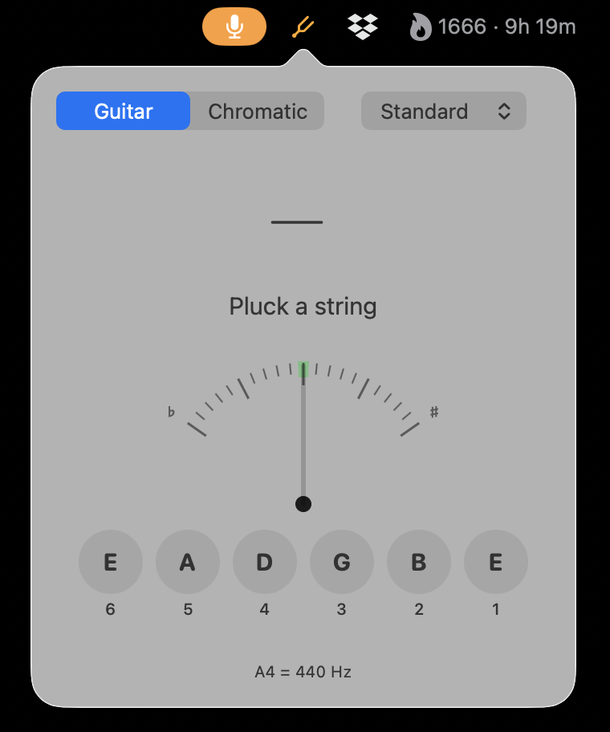

# Tunelet

A menu-bar tuner for guitar and ukulele on macOS 26. See [DESIGN.md](DESIGN.md) for the design and the reasoning behind it.

- **Guitar and chromatic modes.** Guitar mode snaps to the nearest string of the current tuning; chromatic mode shows the nearest note, with an optional low-notes switch for 7- and 8-string guitars.
- **Tunings.** Standard 6-, 7- and 8-string guitar and standard ukulele are built in. Add your own of 4 to 8 strings, spelled with sharps or flats.
- **Reference tones.** Click a string to hear its note.
- **Adjustable.** Set the A4 reference (415–466 Hz) and how close counts as in tune (±1–10¢, default ±2¢).
- **Private by default.** The microphone is only on while the tuning popover is open, and turns itself off after a period of silence.

Detection is tested against real recordings of every string on three acoustic guitars, steel and nylon.

<p align="center">
  
</p>

Builds with the Xcode Command Line Tools alone; Xcode isn't needed.

This is a personal project. There are no released binaries, and it isn't notarized. To use it, build it from source and sign it with your own self-signed certificate (below).

## Scripts

| Command | What it does |
|---|---|
| `scripts/test.sh` | Runs the test suite. Use this rather than a bare `swift test` (see DESIGN.md). |
| `scripts/bundle.sh [debug]` | Builds `build/Tunelet.app` (release by default) and signs it. |
| `scripts/install.sh [--open]` | Release build, quits a running Tunelet, installs to `~/Applications`, and optionally launches it. |
| `swift run tunelet-probe [seconds]` | Prints live pitch readings from the mic, for checking detection against a real guitar. |

## Code signing (one-time setup)

macOS remembers microphone permission against the app's signature. Ad-hoc signatures change on every build, so without a stable identity you'll be asked for mic access again after each rebuild.

1. Open the Certificate Assistant app. On macOS 26 Keychain Access no longer has a Certificate Assistant menu, but the standalone app is still there:
   ```sh
   open "/System/Library/CoreServices/Certificate Assistant.app"
   ```
2. Create a certificate with **Name** `Tunelet Dev` (any name works), **Identity Type** **Self Signed Root** and **Certificate Type** **Code Signing**.
3. Tell the build scripts to use it:
   ```sh
   echo "Tunelet Dev" > .signing-identity
   ```
   `.signing-identity` is gitignored. Setting `TUNELET_SIGN_IDENTITY` works too and takes precedence.
4. Run `scripts/install.sh --open`. The first build signed with the certificate asks for mic access once, and later rebuilds don't.

The first time `codesign` uses the new key, Keychain may ask for permission. Choose **Always Allow**.
